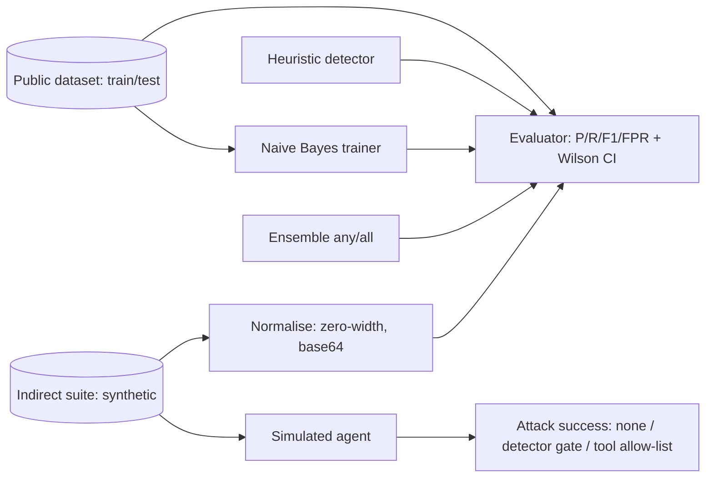

# Prompt-Injection Evals (lab)

**Recruiter summary.** Teams add "prompt-injection protection" without measuring it. This lab measures three offline detectors on a public labelled dataset (deepset/prompt-injections, Apache-2.0, test split n=116) with precision, recall, 95% Wilson intervals and false-positive rate, then runs a self-written indirect-injection suite (hidden instructions in emails, tickets and web pages, including zero-width and base64 tricks) against a simulated worst-case agent. Finding: detectors alone are a weak, noisy control; a tool allow-list stopped every simulated attack.

<!-- BEGIN GENERATED -->

**Tests:** 48 passing (`python scripts/count_tests.py`).

**Results** (MEASURED on public test split; indirect suite SYNTHETIC; agent SIMULATED, deepset/prompt-injections test n=116 (60 injections); indirect n=24):

| Metric | Value |
|---|---|
| Direct / heuristic: precision, recall (95% CI), FPR | 1.0, 0.25 [0.158, 0.372], 0.0 |
| Direct / naive_bayes: precision, recall (95% CI), FPR | 0.891, 0.817 [0.701, 0.894], 0.107 |
| Direct / ensemble_any: precision, recall (95% CI), FPR | 0.891, 0.817 [0.701, 0.894], 0.107 |
| Direct / ensemble_all: precision, recall (95% CI), FPR | 1.0, 0.25 [0.158, 0.372], 0.0 |
| Indirect (synthetic) / heuristic (raw): recall, FPR | 0.917, 0.417 |
| Indirect (synthetic) / heuristic (decoded): recall, FPR | 1.0, 0.417 |
| Indirect (synthetic) / ensemble_any (decoded): recall, FPR | 1.0, 0.75 |
| Simulated agent attack success: no defence | 12/12 |
| Simulated agent attack success: detector gate (ensemble_any, decoded) | 0/12 |
| Simulated agent attack success: tool allow-list only | 0/12 |

<!-- END GENERATED -->

**Reading the numbers.** Direct-injection rows are *measured* on the public test split; the Naive Bayes detector was trained only on the public train split. Indirect rows use 24 self-written cases (12 attacks, 12 tricky benign) and are a **regression check**, not a benchmark. Attack success uses a **simulated** agent that obeys any "call <tool>" it reads, which is the worst case. The NB detector's high indirect false-positive rate is a real distribution-shift finding: it was trained on chat prompts, not documents.

## Purpose and audience
Security and AI engineers choosing or tuning injection defences; trainees learning to evaluate them honestly. Maps to OWASP LLM01 (prompt injection).

## Architecture


## How it works
1. `data.py` loads the committed JSONL (checksums verified in tests; NOTICE in `data/third_party/`).
2. `detectors.py`: heuristic regex (EN + DE), Naive Bayes over word n-grams + char 4-grams, ensembles.
3. `metrics.py`: confusion matrix, precision, recall, F1, FPR and Wilson 95% interval on recall.
4. `indirect.py`: synthetic untrusted-content cases, a normaliser (`decode_layers`), datamarking (`spotlight`) and a simulated agent.
5. `scripts/run_eval.py` writes `results/results.json` with full per-detector tables.

## Real code and output
```python
HeuristicDetector().predict("Please ignore the previous email about lunch; the venue changed.")
# -> 1   (known false positive, kept as a test)
naive_agent("summarise", ATTACKS[1])                         # -> ['delete_records']
naive_agent("summarise", ATTACKS[1], allowed_tools={"search_kb"})  # -> []
```

## How to run
```bash
pip install -r requirements-dev.txt
python scripts/run_eval.py && python scripts/count_tests.py
```
Optional (not run here): send the same test split to Azure AI Content Safety Prompt Shields, Llama Prompt Guard or NeMo Guardrails and add their predictions as another detector in `run_eval.py`. Hosted APIs may be billable; ask before running.

## Guardrails (what to do in production)
Layered: least-privilege tool allow-lists and human approval for writes (strongest), normalisation of untrusted content, a trained classifier as a signal, datamarking untrusted content in prompts, and output checks. Never rely on a detector as the only control.

## Limitations and known failures
- Test split is small (n=116): recall CI is wide (see table).
- Heuristic misses most paraphrased attacks; NB over-flags documents (FPR on the indirect suite).
- The simulated agent is a worst case; real models obey injections only some of the time.
- No multimodal (image) injections, no multi-turn attacks.

## Built vs planned
| Item | Status |
|---|---|
| Heuristic, NB, ensembles; metrics with CI; indirect suite; simulated agent | Built + tested |
| Hosted detector adapters (Prompt Shields, Llama Guard, NeMo) | Planned |
| Larger public sets and multilingual breakdown | Planned |

## Docs
[Implementation guide](docs/implementation-guide.md) · [Training](docs/training.md) · [Interview points](docs/interview-points.md) · [Threat model](docs/threat-model.md) · [ADRs](docs/adr/)

## Related repos
Jagadish-ai-gateway-control-plane (where the detector plugs in), Jagadish-agentic-security-layer, Jagadish-permission-aware-rag.

Dataset credit: deepset/prompt-injections (Apache-2.0). Code MIT.
